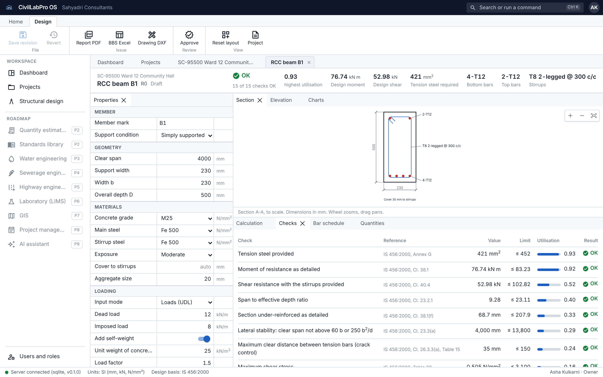
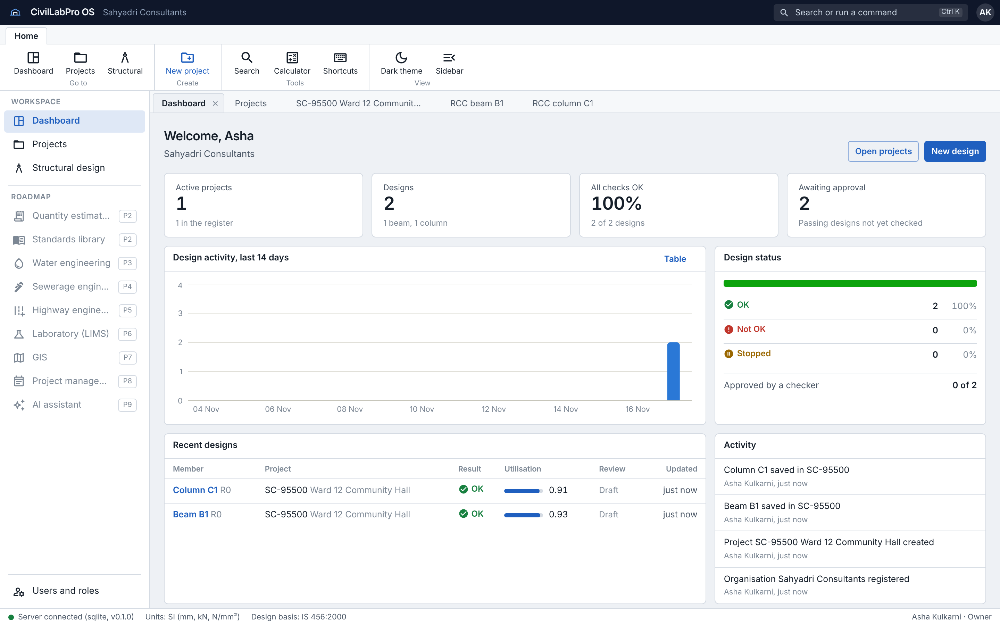

# CivilLabPro OS

An Indian civil engineering operating system: design to Indian Standards, estimation, laboratory, GIS and project control in one application, for the web, as a PWA and (planned) as a desktop install.

**Version 0.2.0.** The platform core and two structural engines are built and tested. The remaining modules are designed and scheduled; see the roadmap.

| Module | State |
|---|---|
| Dashboard, projects, users and roles | built |
| Structural design: RCC beam to IS 456:2000 | built (engine 1.0.0) |
| Structural design: RCC column to IS 456:2000 | built (engine 1.0.0); clauses still to be compared with the printed code |
| Structural design: slab, footing and others | next |
| Estimation, standards library, water, sewerage, highway, laboratory, GIS, project management, AI assistant | designed, not started |

## What works today

* Organisations, users, five roles, an audit trail, tenant isolation.
* Projects.
* Beam design: flexure, shear, torsion, deflection and detailing checks, each line with its clause and each limit with a verdict.
* Column design: effective length, slenderness, minimum eccentricity, additional moments, biaxial bending by strain compatibility, ties and cross-ties, with interaction diagrams.
* Bar bending schedule, quantities and a to-scale drawing from the same calculation.
* Calculation report (PDF), bar schedule (Excel), drawing (DXF).
* Revisions, and approval by a second engineer.
* A workspace with dockable panels, a ribbon, document tabs, Ctrl K search, a floating calculator, light and dark themes.

## Screens

Design workspace: inputs on the left, drawings above the calculation, every panel dockable.


| Checks, worst first | Dark theme | Dashboard |
|---|---|---|
|  |  |  |

Column workspace with its interaction diagrams:


Sample output of the worked examples, produced by the running application:

| Element | Report | Bar schedule | Drawing |
|---|---|---|---|
| Beam B1 | [PDF](docs/samples/beam_B1_R0_report.pdf) | [Excel](docs/samples/beam_B1_R0_bbs.xlsx) | [DXF](docs/samples/beam_B1_R0.dxf) |
| Column C1 | [PDF](docs/samples/column_C1_R0_report.pdf) | [Excel](docs/samples/column_C1_R0_bbs.xlsx) | [DXF](docs/samples/column_C1_R0.dxf) |

## Run it

Needs Python 3.11 or later and Node 22.

```bash
# API
cd backend
python -m venv .venv && . .venv/bin/activate
pip install -e ".[dev]"
alembic upgrade head
uvicorn app.main:app --reload            # http://127.0.0.1:8000/api/docs

# web client (second terminal)
cd frontend
npm ci
npm run dev                              # http://127.0.0.1:5173
```

Create an organisation on the sign-in screen, add a project, then choose **New RCC beam** or **New RCC column**.

SQLite is the default database and needs nothing installed. For PostgreSQL set `CLP_DATABASE_URL` (see `backend/.env.example`). To run the API and the built client as one process: `npm run build` in `frontend`, then start the API with `CLP_STATIC_DIR=../frontend/dist`. Containers: see `deploy/docker-compose.yml`.

## Check it

```bash
cd backend  && ruff check app tests alembic && pytest && python tests/handcheck/check_beam.py && python tests/handcheck/check_column.py
cd frontend && npm run typecheck && npm test && npm run build
node e2e/walkthrough.js <folder for screenshots>      # both servers running
```

## Documents

| Document | Read it for |
|---|---|
| [docs/PROJECT_MEMORY.md](docs/PROJECT_MEMORY.md) | current status, next steps, decisions, conventions. Start here. |
| [docs/ARCHITECTURE.md](docs/ARCHITECTURE.md) | the whole system: layers, modules, runtime, security, client |
| [docs/DATABASE_SCHEMA.md](docs/DATABASE_SCHEMA.md) | tables built and tables planned |
| [docs/ROADMAP.md](docs/ROADMAP.md) | phases and what closes each |
| [docs/BACKLOG.md](docs/BACKLOG.md) | work items in order, and the definition of done |
| [docs/CODE_REGISTER.md](docs/CODE_REGISTER.md) | codes used, clauses taken, interpretations, items to cross-check |
| [docs/modules/01-platform-core-and-beam.md](docs/modules/01-platform-core-and-beam.md) | 0.1.0: platform core and beam: endpoints, engineering logic, validation, tests, deployment |
| [docs/modules/02-rcc-column.md](docs/modules/02-rcc-column.md) | 0.2.0: column: engineering logic, validation, tests |

## A note on engineering use

The engines implement the clauses listed in the code register and are checked by independent hand calculations, but they are design aids. The register lists table values that still need cross-checking against a printed, fully amended copy of the code. Results must be reviewed by a qualified engineer before they are built from.

Report fonts: DejaVu Sans, bundled under its own licence (`backend/app/assets/fonts/LICENSE-DejaVu.txt`).
