# CivilLabPro OS

An Indian civil engineering operating system: design to Indian Standards, estimation, laboratory, GIS and project control in one application, for the web, as a PWA and as a desktop install for Windows and Linux.

**Version 0.6.0.** Phase 1 is complete: the platform core and the structural engines (beam, continuous beam, column, slab, isolated and combined footing) are built and tested. Release 0.6.0 adds the combined footing, face moments at monolithic supports and cantilever ends for continuous beams, and backup, restore and moving projects between installations. The remaining modules are designed and scheduled; see the roadmap.

| Module | State |
|---|---|
| Dashboard, projects, users and roles | built |
| Desktop app for Windows and Linux (Electron, offline, SQLite) | built (installers from CI; not code-signed) |
| Backup, restore, project export and import | built ([docs/OPERATIONS.md](docs/OPERATIONS.md)) |
| Structural design: RCC beam (rectangular, T, L) to IS 456:2000 | built (engine 1.4.0) |
| Structural design: RCC continuous beam (Tables 12 and 13, or elastic analysis of any spans, point loads and cantilever ends with redistribution, supports of their own widths) | built (engine 1.7.0) |
| Structural design: RCC column to IS 456:2000 | built (engine 1.0.0); clauses still to be compared with the printed code |
| Structural design: RCC slab (one-way, two-way) to IS 456:2000 | built (engine 1.0.0); Table 26 rows still to be compared with the printed code |
| Structural design: RCC isolated footing to IS 456:2000 | built (engine 1.1.0) |
| Structural design: RCC combined footing under two columns | built (engine 1.1.0) |
| Structural design: RCC strap footing (a column at a property line) | built (engine 1.0.0) |
| Structural design: trapezoidal footing, staircase, retaining wall and others | phase 2 |
| Estimation, standards library, water, sewerage, highway, laboratory, GIS, project management, AI assistant | designed, not started |

## What works today

* Organisations, users, five roles, an audit trail, tenant isolation.
* Projects.
* Beam design: rectangular, T and L sections; flexure, shear, torsion, deflection and detailing checks, each line with its clause and each limit with a verdict; bars curtailed and stirrups zoned along the span, with the anchorage at the supports checked (Cl. 26.2.3).
* Continuous beam design: equal spans by Tables 12 and 13, or any spans, point loads and cantilever ends by elastic analysis with redistribution, the supports at their centre lines or (monolithic) at their faces; one schedule and an elevation of every span.
* Column design: effective length, slenderness, minimum eccentricity, additional moments, biaxial bending by strain compatibility, ties and cross-ties, with interaction diagrams.
* Slab design: one panel by its spans and the condition of its four edges; one-way strips (simply supported or Tables 12 and 13) or two-way panels (Table 26 held down, Table 27 free), flexure, shear, deflection, corner torsion steel, top and bottom steel with Annex D extents.
* Isolated footing design: plan size from the bearing pressure with moments both ways, depth from bending, one-way and punching shear, central band steel, development length (with end bends where needed), bearing at the column base.
* Combined footing design: two columns on one footing, centred on their loads and moments or set from a property line; bending and shear along and across, bands of steel under the columns, punching round each, development at the stress of each section, bearing under both columns.
* Strap footing design: a column at a property line on an eccentric pad, tied by a strap beam to an interior column; reactions by statics, the strap's bending and shear with stirrups, both pads, bearing.
* Bar bending schedule, quantities and a to-scale drawing from the same calculation.
* Calculation report (PDF), bar schedule (Excel), drawing (DXF).
* Revisions, and approval by a second engineer.
* Backup of the database, restore on the desktop, and projects exported and imported between installations as calculated.
* A workspace with dockable panels, a ribbon, document tabs, Ctrl K search, a floating calculator, light and dark themes.

## Screens

Design workspace: inputs on the left, drawings above the calculation, every panel dockable.

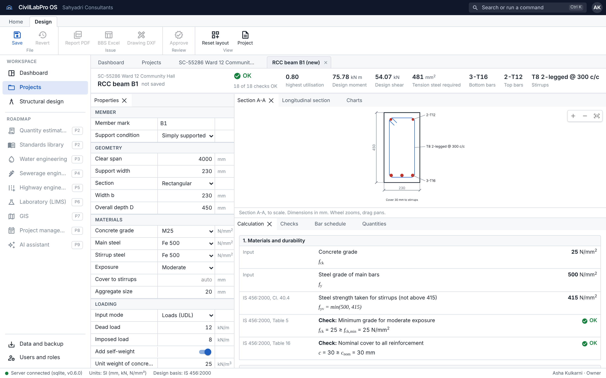

| Checks, worst first | Dark theme | Dashboard |
|---|---|---|
|  | 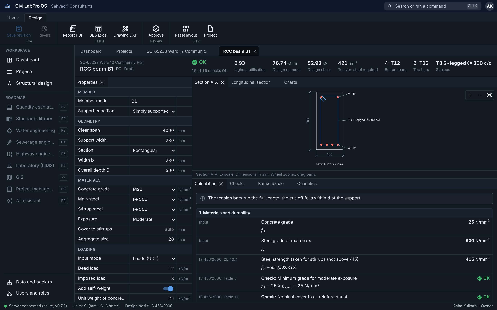 |  |

Column workspace with its interaction diagrams:

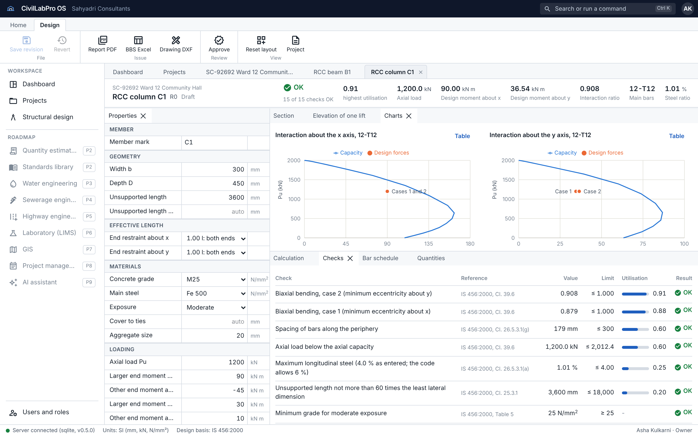

| Two-way slab panel | Isolated footing |
|---|---|
| 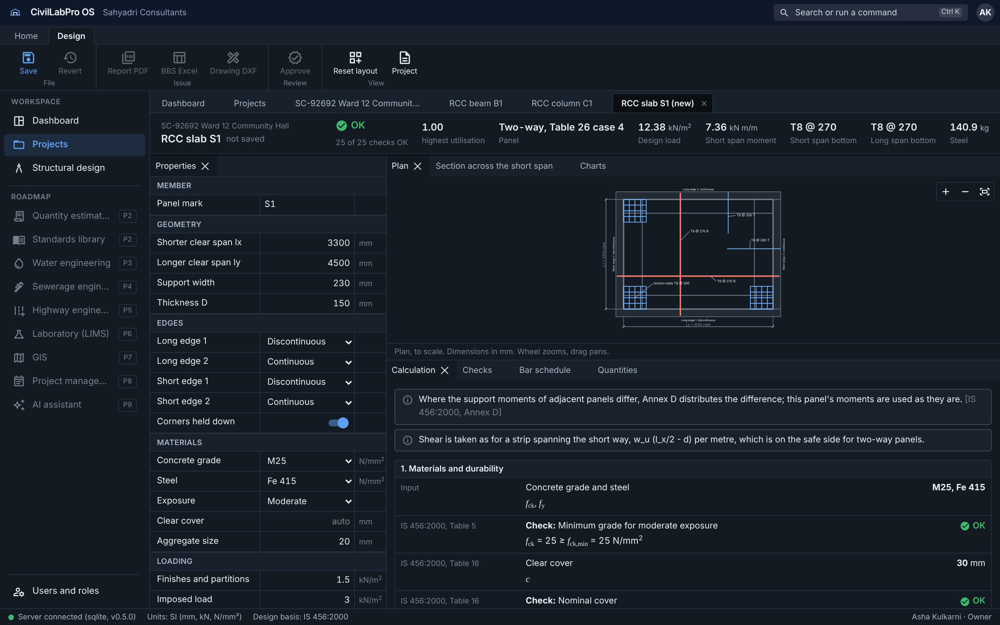 | 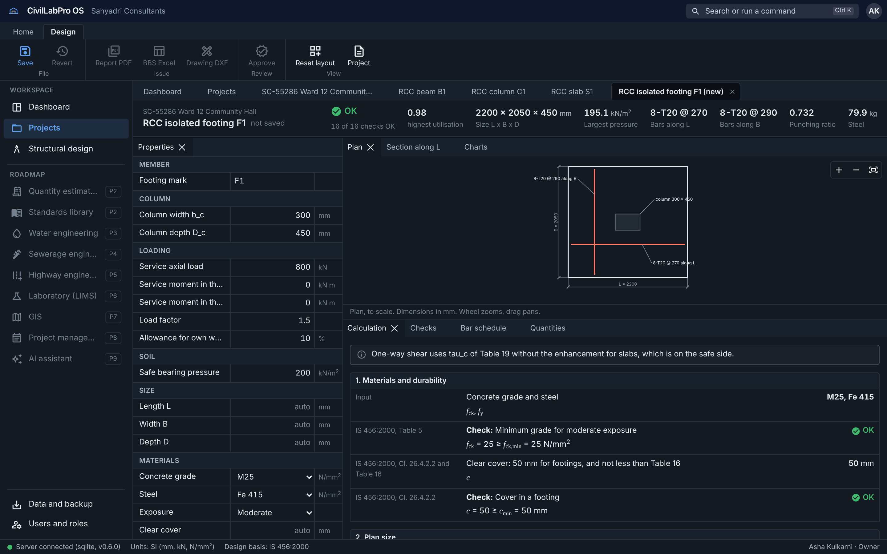 |

Continuous beam: the whole beam in one design, with long and short top bars over the supports and curtailed bottom bars:

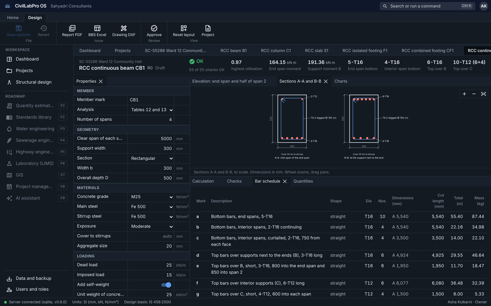

Continuous beam by elastic analysis: spans of any length and point loads in tables, redistribution of support moments, an elevation of every span, and the design envelopes:

| Spans, schedule and the elevation of span 4 | Moment and shear envelopes |
|---|---|
| 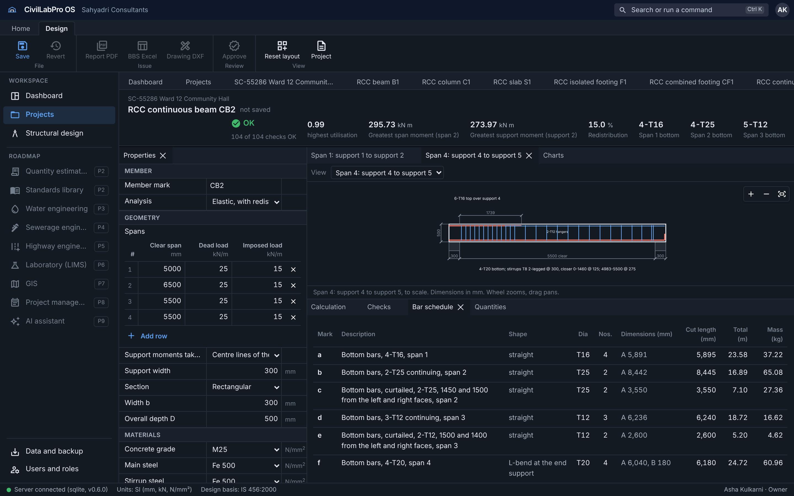 | 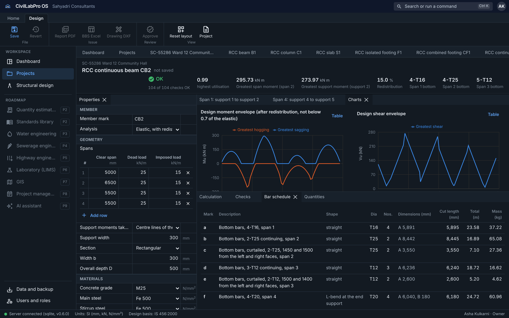 |

Combined footing: two columns on one footing, with its bending and shear along, bands of steel under the columns, a plan and two sections:

| Plan and summary | Section along, and the schedule |
|---|---|
| 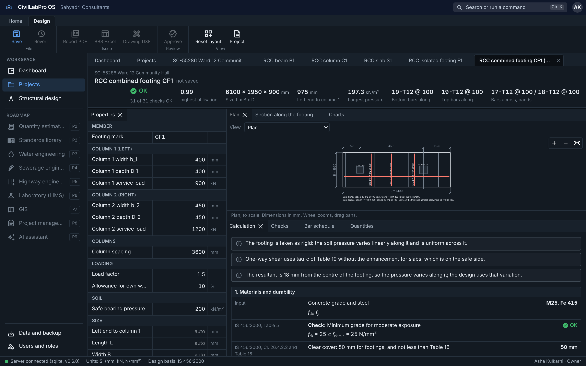 | 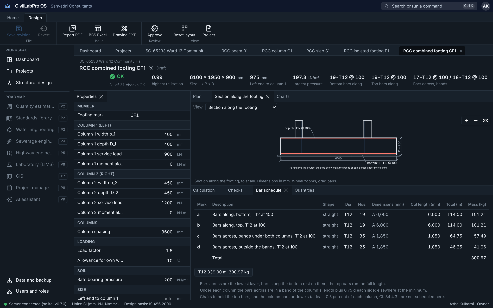 |

Backup and moving projects: a project exported from one installation and imported into another as calculated, and the backup page:

| Imported project | Data and backup |
|---|---|
| 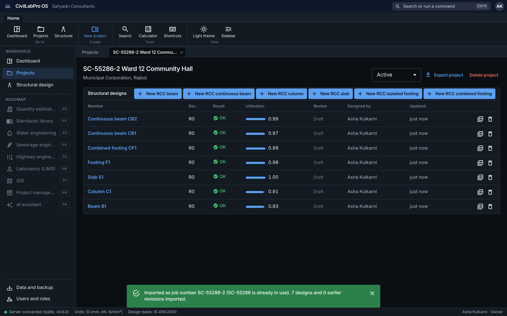 | 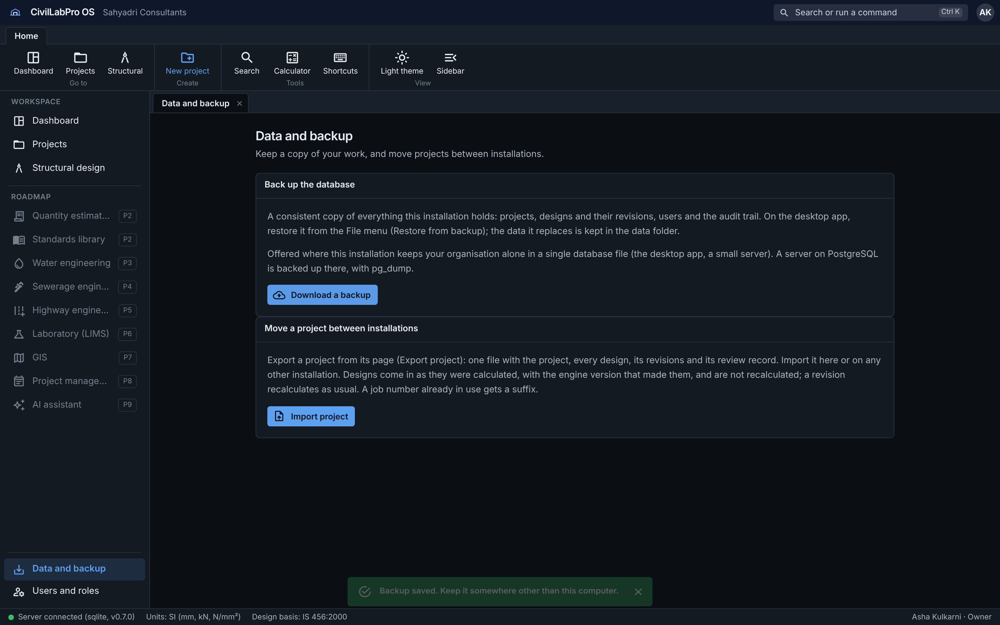 |

Sample output of the worked examples, produced by the running application:

| Element | Report | Bar schedule | Drawing |
|---|---|---|---|
| Beam B1 | [PDF](docs/samples/beam_B1_R0_report.pdf) | [Excel](docs/samples/beam_B1_R0_bbs.xlsx) | [DXF](docs/samples/beam_B1_R0.dxf) |
| Continuous beam CB1 | [PDF](docs/samples/continuous_beam_CB1_R0_report.pdf) | [Excel](docs/samples/continuous_beam_CB1_R0_bbs.xlsx) | [DXF](docs/samples/continuous_beam_CB1_R0.dxf) |
| Continuous beam CB2 (elastic, four unequal spans, a point load) | [PDF](docs/samples/continuous_beam_CB2_R0_report.pdf) | [Excel](docs/samples/continuous_beam_CB2_R0_bbs.xlsx) | [DXF](docs/samples/continuous_beam_CB2_R0.dxf) |
| Column C1 | [PDF](docs/samples/column_C1_R0_report.pdf) | [Excel](docs/samples/column_C1_R0_bbs.xlsx) | [DXF](docs/samples/column_C1_R0.dxf) |
| Slab S1 | [PDF](docs/samples/slab_S1_R0_report.pdf) | [Excel](docs/samples/slab_S1_R0_bbs.xlsx) | [DXF](docs/samples/slab_S1_R0.dxf) |
| Footing F1 | [PDF](docs/samples/footing_F1_R0_report.pdf) | [Excel](docs/samples/footing_F1_R0_bbs.xlsx) | [DXF](docs/samples/footing_F1_R0.dxf) |
| Combined footing CF1 | [PDF](docs/samples/combined_footing_CF1_R0_report.pdf) | [Excel](docs/samples/combined_footing_CF1_R0_bbs.xlsx) | [DXF](docs/samples/combined_footing_CF1_R0.dxf) |

## Run it

Needs Python 3.11 or later and Node 22.

```bash
# API
cd backend
python -m venv .venv && . .venv/bin/activate
pip install -e ".[dev]"
alembic upgrade head
uvicorn app.main:app --reload            # http://127.0.0.1:8000/api/docs

# web client (second terminal)
cd frontend
npm ci
npm run dev                              # http://127.0.0.1:5173
```

Create an organisation on the sign-in screen, add a project, then choose **New RCC beam**, **New RCC continuous beam**, **New RCC column**, **New RCC slab**, **New RCC isolated footing**, **New RCC combined footing** or **New RCC strap footing**.

**Desktop:** `desktop/` holds the Electron app (Windows and Linux installers, the data in a SQLite file in the user's folder); see [desktop/README.md](desktop/README.md). SQLite is the default database and needs nothing installed. For PostgreSQL set `CLP_DATABASE_URL` (see `backend/.env.example`). To run the API and the built client as one process: `npm run build` in `frontend`, then start the API with `CLP_STATIC_DIR=../frontend/dist`. Containers: see `deploy/docker-compose.yml`.

## Check it

```bash
cd backend  && ruff check app tests alembic && pytest     # pytest runs every hand check in tests/handcheck/ too
for f in tests/handcheck/check_*.py; do python "$f"; done   # the same hand checks, with their reports
cd frontend && npm run typecheck && npm test && npm run build
node e2e/walkthrough.js <folder for screenshots>      # both servers running
```

## Documents

| Document | Read it for |
|---|---|
| [docs/PROJECT_MEMORY.md](docs/PROJECT_MEMORY.md) | current status, next steps, decisions, conventions. Start here. |
| [docs/ARCHITECTURE.md](docs/ARCHITECTURE.md) | the whole system: layers, modules, runtime, security, client |
| [docs/DATABASE_SCHEMA.md](docs/DATABASE_SCHEMA.md) | tables built and tables planned |
| [docs/ROADMAP.md](docs/ROADMAP.md) | phases and what closes each |
| [docs/BACKLOG.md](docs/BACKLOG.md) | work items in order, and the definition of done |
| [docs/CODE_REGISTER.md](docs/CODE_REGISTER.md) | codes used, clauses taken, interpretations, items to cross-check |
| [docs/modules/01-platform-core-and-beam.md](docs/modules/01-platform-core-and-beam.md) | 0.1.0: platform core and beam: endpoints, engineering logic, validation, tests, deployment |
| [docs/modules/02-rcc-column.md](docs/modules/02-rcc-column.md) | 0.2.0: column: engineering logic, validation, tests |
| [docs/modules/03-slab-and-footing.md](docs/modules/03-slab-and-footing.md) | 0.3.0: slab and isolated footing: engineering logic, validation, tests |
| [docs/modules/04-beam-extensions.md](docs/modules/04-beam-extensions.md) | 0.4.0: T and L beams, continuous beams, curtailment and stirrup zones, anchorage at supports |
| [docs/modules/05-anchorage-spans-desktop.md](docs/modules/05-anchorage-spans-desktop.md) | 0.5.0: U-hooks, anchorage in the continuous beam's bar selection, continuous beams of any spans and point loads by elastic analysis, the desktop shell |
| [docs/modules/06-faces-cantilevers-backup-combined-footing.md](docs/modules/06-faces-cantilevers-backup-combined-footing.md) | 0.6.0: face moments and cantilever ends of continuous beams, backup and restore, the combined footing |
| [docs/modules/07-footing-moments-strap-spans.md](docs/modules/07-footing-moments-strap-spans.md) | 0.7.0 (in progress): column moments on combined footings, strap footings, supports of their own widths |
| [docs/OPERATIONS.md](docs/OPERATIONS.md) | Backup, restore and moving projects between installations |

## A note on engineering use

The engines implement the clauses listed in the code register and are checked by independent hand calculations, but they are design aids. The register lists table values that still need cross-checking against a printed, fully amended copy of the code. Results must be reviewed by a qualified engineer before they are built from.

Report fonts: DejaVu Sans, bundled under its own licence (`backend/app/assets/fonts/LICENSE-DejaVu.txt`).
