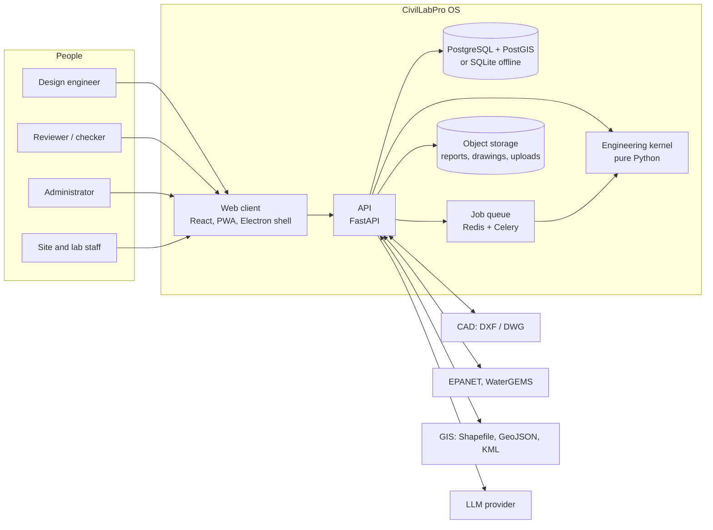
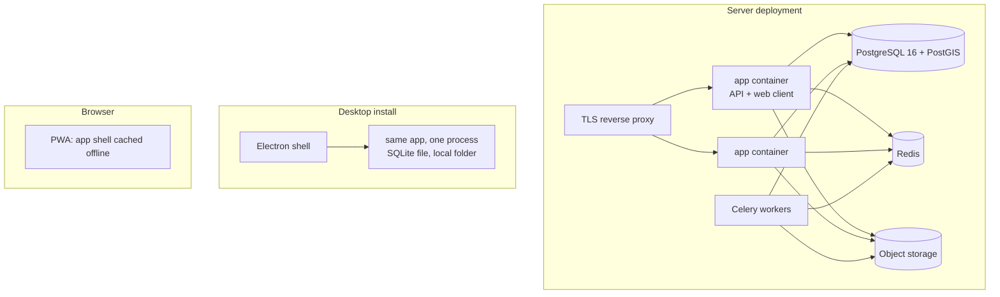

# CivilLabPro OS: software architecture

Status: version 0.3 (platform core and four structural engines, beam, column, slab and isolated footing, are built; see [ROADMAP.md](ROADMAP.md)).
This document describes the whole platform. Sections say which parts exist today and which are designed but not yet built.

## 1. What the system is

One application for the work an Indian civil engineering organisation does: design to Indian codes, estimation against schedules of rates, laboratory testing, GIS, project control and document issue. Today that work is split across separate analysis packages, CAD, spreadsheets and paper. The platform replaces the switching with one project record that every module reads and writes.

Users: design consultants, contractors, government departments (PHED, water boards, municipal corporations, R&B), NABL laboratories, universities and students.

Three properties drive every decision below:

1. **Engineering results must be checkable.** A calculation is a list of lines, each citing its clause, and a list of limits, each with a verdict. Nothing is computed out of sight.
2. **One codebase, four ways to run it.** A web deployment, a PWA, and a desktop install on Windows and Linux that works without a network.
3. **Eleven modules, built one at a time, must not collide.** Module boundaries are enforced by tests, not by convention.

## 2. System context



Built today: web client, API, engineering kernel, database (both engines), DXF export. Designed, not built: job queue, object storage, the other integrations.

## 3. Architecture style

A **modular monolith** with clean-architecture layering inside each module.

Why a monolith: the modules share one transactional record (a project and what hangs from it), the team is small, and the desktop install must run as one process. Why modular: each module must be buildable and replaceable alone, and a module that later needs its own scaling (network solvers, the AI assistant) can be lifted out along a boundary that already exists.

### 3.1 Layers

```
            +---------------------------------------------------------+
  outside   |  router.py (HTTP)   exports/ (PDF, XLSX, DXF)   models.py |   frameworks
            +---------------------------------------------------------+
  use cases |  service.py: validate, call the domain, persist, audit    |   application
            +---------------------------------------------------------+
  inside    |  domain/: inputs, design rules, results                   |   pure Python
            |  app/engineering/: code rules, calc sheet, drawing model  |   pure Python
            +---------------------------------------------------------+
```

Dependencies point inwards only. `tests/unit/test_architecture.py` fails the build if:

* anything under `app/engineering/` or `app/modules/*/domain/` imports FastAPI, Starlette, SQLAlchemy, Alembic or an export library;
* the kernel imports a module, or a module's domain imports another module.

Pydantic is allowed in the domain: it is the value-object and validation library, and its JSON schema is what the client builds the input form from.

### 3.2 Bounded contexts

| Context | Owns | State |
|---|---|---|
| identity | organisations, users, sessions, roles, audit trail | built |
| projects | project register (the aggregate every module references) | built |
| structural | member designs, revisions, approval, reports | built for beams |
| dashboard | read models and search across contexts (queries only) | built |
| standards | code register, clause index, search, bookmarks | designed |
| estimation | SOR, rate analysis, BOQ, measurement, bills | designed |
| water | demand, networks, reservoirs, pumping, treatment | designed |
| sewerage | sewer networks, STP process design, pumping | designed |
| highway | pavement, geometry, drainage, road inventory | designed |
| lims | samples, tests, NABL reports, verification | designed |
| gis | layers, features, utility networks | designed |
| pm | schedule, resources, DPR, RFI, quality, safety, documents | designed |
| assistant | retrieval over standards, calculation review, drafting | designed |

Contexts talk through application services and IDs, never through each other's tables. The one sanctioned exception is the dashboard context, which is read-only by definition.

### 3.3 The element registry (how a module grows without new plumbing)

`app/modules/structural/domain/registry.py` maps an element type to its input model and design function. Everything outside the domain is written against the registry:

* one calculate endpoint, `POST /structural/{element_type}/calculate`;
* one table, `structural_designs`, holding inputs and results as documents;
* one PDF, Excel and DXF exporter, reading the generic result;
* one workspace screen, whose property grid is generated from the input model's JSON schema (title, unit, group, limits, conditional rows);
* one chart renderer on screen and in the PDF, for the optional `charts` of a result (axes and series of points).

The column (0.2.0) was the first test of this claim: it added a domain module, its detailing, a hand check and a registry entry. The one shared change it needed, charts, was made to the contract, so every later element can use it.

The slab and the footing (0.3.0) were the second test. Each was a domain module, its detailing, a hand check and a registry entry; the slab's tables went into a kernel module (`is456_slabs.py`) that the footing reuses for minimum steel. The shared changes were small and general: the workspace's two drawing tabs now show an element's first and second views and take their titles (a plan for slabs and footings, a section for members), and the drawing model gained vertical text.

Adding a column, slab or footing is therefore: a domain module, a hand check, a registry entry. No endpoint, migration, exporter or screen. The same pattern is the template for the water, sewerage and highway engines.

## 4. The engineering kernel

`app/engineering/` is the part that must be right. It has these pieces.

**Calculation sheet** (`trace.py`). Engines do not return numbers; they return a sheet: sections of *steps* (reference, description, symbolic equation, substituted numbers, value, unit) and *checks* (demand, operator, capacity, verdict, utilisation), plus *flags* for the designer. The screen, the PDF and the tests all read this one structure, so they cannot disagree.

**Code rules** (`is456.py` and `is456_slabs.py`, later `is3370.py`, `irc37.py`, `cpheeo.py` and so on). One function per clause, named for what it computes, with the clause in its docstring. Tables are transcribed once and cross-checked by tests against a second source where one exists (Table 19 against the SP 16 closed form; the steel curve against SP 16 Table F; Table 27 generated from its Rankine-Grashoff expressions and compared with the printed values).

**Drawing model** (`drawing.py`). A drawing is a list of primitives in millimetres. The canvas renders it as SVG, the exporter writes it as DXF with real DIMENSION entities, the report embeds it. One description, three outputs.

**Reinforcement data** (`rebar.py`). Bar sizes, areas, unit masses.

**Section analysis** (`rc_section.py`). A rectangular section under axial load and bending by strain compatibility (Cl. 39.1): the Fig. 21 block integrated in closed form for any neutral-axis depth, bars on the Fig. 23 curves, the capacity at an axial load, the balanced state and the interaction curve. Used by the column; footings, walls and pile caps will use it.

Rules for every engine:

1. Pure function of its inputs. No database, no clock, no randomness. The same inputs give the same sheet on every machine, which is what makes a stored design reproducible and an approval meaningful.
2. A failed limit is a result, not an exception. The engine reports `not_ok` with the check that failed. It stops only when it cannot go on (deep beam, no bar arrangement fits), and then says what to change.
3. Every engine carries a version. A stored design records the engine version that produced it.
4. Every engine has an independent hand check (`tests/handcheck/check_*.py`) written from the code text by a different route, run in CI.
5. Code interpretations are recorded in [CODE_REGISTER.md](CODE_REGISTER.md), not buried in code.

## 5. Runtime topology



* **Web**: stateless application containers behind a proxy; PostgreSQL holds all state. Built and verified (without the proxy, Redis and workers, which nothing uses yet).
* **Single-process mode**: with `CLP_STATIC_DIR` set, the API process also serves the built client. This is the small-server deployment and exactly what the desktop shell will start. Built and verified end to end in a browser.
* **Desktop** (phase 2): an Electron shell that starts the packaged backend against a SQLite file in the user's data folder and opens the client. The backend already runs unchanged on SQLite; the shell itself is not yet written.
* **PWA**: manifest and service worker are generated at build. The shell loads offline; API calls need the server. Offline editing with sync is a later decision (see section 11).

### 5.1 Long-running work (designed)

Interactive calculations (a member design takes 10 to 100 ms) run in the request. Work that can take seconds or more goes to Celery through Redis: pipe-network solves, batch reports, large imports, AI calls. The API returns a job ID; progress and completion reach the client over a WebSocket channel per user. The queue is introduced with the first module that needs it (water networks), not before.

## 6. Data architecture

Full schema: [DATABASE_SCHEMA.md](DATABASE_SCHEMA.md).

* **One schema, two engines.** Every model uses portable types (UUID keys, UTC timestamps, JSON documents that become JSONB on PostgreSQL). The same Alembic history runs on PostgreSQL and SQLite; a test compares the migrated schema with the models on both.
* **Multi-tenancy by organisation.** Every business row carries `org_id`. Every query in a service filters by the caller's organisation, and another tenant's record reads as *not found*, never *forbidden*. Tests attack this boundary on every endpoint.
* **Documents beside columns.** A design's inputs and full result are JSON documents; the columns beside them (status, utilisation, revision, review state) are what lists and dashboards query. New element types need no migration.
* **Revisions, not overwrites.** Saving new inputs archives the previous state. An issued calculation can always be reproduced.
* **Audit trail.** An append-only log of who did what, written in the same transaction as the change.
* **Spatial data** (designed): PostGIS geometry columns on PostgreSQL; on SQLite the same features are stored as GeoJSON with bounding-box columns, which is enough for the desktop viewer.
* **Files** (designed): object storage (S3-compatible on servers, a folder on desktop) behind one port; the database stores keys and hashes, not blobs.

## 7. Security

| Concern | Decision |
|---|---|
| Passwords | Argon2id; rehash on login when parameters change |
| Sessions | 30-minute JWT access token (memory only in the client) and a rotating opaque refresh token stored as a SHA-256 digest |
| Token theft | A reused refresh token ends every session of that user |
| Brute force | Five failed logins lock the account for 15 minutes |
| Authorisation | Endpoints require a permission (`design:approve`), roles map to permission sets; five system roles |
| Four-eyes rule | A design is approved by someone other than its designer, and only when every check is OK; revising it withdraws the approval |
| Tenancy | Organisation filter in every service; cross-tenant access returns 404 |
| Input | Pydantic validation at the edge and again in the domain; unknown fields are rejected |
| Errors | One envelope `{"error": {"code", "message", "details"}}`; no stack traces leave the server |
| Production guard | The server refuses to start in production with the development secret or (unless explicitly allowed) SQLite |
| Static files | Path traversal out of the client folder is blocked and tested |

Open items, tracked in the backlog: move the web refresh token to an httpOnly cookie, OAuth2 / OIDC single sign-on, per-project membership, rate limiting at the proxy, digital signatures on issued reports.

## 8. Client architecture

React 19, TypeScript (strict), Vite, Tailwind for layout, MUI for controls, TanStack Query for server state, Zustand for interface state, React Hook Form for forms.

```
src/
  api/         client (token refresh, error envelope, downloads), types, query hooks
  app/         theme, module registry
  stores/      auth, ui (tabs, ribbon, palette, calculator)
  shell/       ribbon, sidebar, document tabs, status bar, command palette, floating calculator
  components/  property grid, drawing canvas, calculation sheet, schedule, status
  pages/       sign-in, dashboard, projects, structural, design workspace, users
  lib/         calculator parser, formatting
```

* **Shell**: a ribbon with a Home tab and a contextual tab the current page registers; a module sidebar that also shows the roadmap; open documents as tabs; a status bar with server state; Ctrl K for commands and search; a draggable calculator; light and dark themes.
* **Design workspace**: dockable panels (dockview). Inputs change, are validated against the schema limits, debounced, and sent to the calculate endpoint; the previous result stays on screen until the new one arrives. Reports are issued only from a saved revision.
* **Schema-driven forms**: the property grid is generated from the element's JSON schema. The client holds no per-element form code.
* **Code splitting**: the dashboard (charts), the workspace (docking) and administration load on demand.
* **No external requests**: fonts and icons are bundled, so the desktop install works offline.

## 9. AI assistant (designed)

The assistant will explain codes, review calculations and draft documents. Three constraints shape it:

1. **It never produces a design number.** Numbers come from the kernel. The assistant is given the kernel's engines as tools and returns their calculation sheets; its own text explains and cites.
2. **It answers from the standards library, with citations.** Retrieval over the clause index (PostgreSQL full-text search plus vector search with pgvector), and every statement about a code carries the clause it came from. No citation, no claim.
3. **The provider sits behind a port.** An LLM gateway interface with one adapter per provider; the default adapter targets the Claude API with the model set in configuration. Prompts, tool definitions and evaluation sets are versioned in the repository. Calls go through the job queue and are logged to the audit trail.

Copyright: most Indian Standards are copyrighted by BIS. The library stores clause references, the organisation's own notes and licensed text the organisation uploads; it does not ship code text.

## 10. Quality

| Level | What | Where |
|---|---|---|
| Rule | each clause function against printed values | `tests/unit/test_is456.py` |
| Engine | worked example, every branch, stop states, a sweep of several hundred inputs | `tests/unit/test_beam.py` |
| Hand check | independent recomputation by a different method | `tests/handcheck/` |
| Architecture | layering rules | `tests/unit/test_architecture.py` |
| API | auth, roles, tenancy, revisions, approval, exports | `tests/api/` on SQLite and PostgreSQL |
| Schema | migrations equal models | `tests/api/test_migrations.py` |
| Client | calculator, markup, property grid, sheet, drawing | `src/**/*.test.ts(x)` |
| End to end | a browser walkthrough of the whole flow | `e2e/walkthrough.js` |

CI (`.github/workflows/civillabpro-ci.yml`) runs all but the last on every push.

## 11. Decisions still open

| Question | Options | Decide by |
|---|---|---|
| Offline editing on desktop: local-only projects, or sync with a server | local file with export/import; or change log and merge | phase 2 |
| Frame analysis | own stiffness solver; or import forces from STAAD / ETABS files | before the column engine |
| DWG | DXF only; or ODA converter under licence | GIS phase |
| EPANET | call the open-source EPANET toolkit; or own solver | water phase |
| Report signing | organisation certificate (DSC); or hash and QR verification only | LIMS phase |

## 12. Folder structure

```
civillabpro/
  README.md
  Dockerfile                     one image: API + built client
  deploy/                        docker-compose.yml, .env.example
  docs/                          this file, schema, roadmap, backlog, code register, project memory, module notes
  e2e/walkthrough.js             browser walkthrough
  backend/
    pyproject.toml  alembic.ini  alembic/versions/
    app/
      main.py                    assembles routers; optional client serving
      core/                      config, database, security, errors, dependencies
      engineering/               trace, is456, is456_slabs, rebar, drawing, rc_section   (pure)
      assets/fonts/              report fonts
      modules/
        identity/                models, schemas, permissions, service, router
        projects/                models, schemas, service, router
        structural/
          domain/                beam, column, slab, footing and their detailing, registry   (pure)
          exports/               pdf_report, bbs_xlsx, dxf
          models, schemas, service, router
        dashboard/               router (read models, search)
        models_registry.py
    tests/  unit/  api/  handcheck/
  frontend/
    package.json  vite.config.ts  index.html
    src/  api/  app/  stores/  shell/  components/  pages/  lib/
```

A new module adds `backend/app/modules/<name>/` (with its own `domain/`), one include in `main.py`, one import in `models_registry.py`, one migration, one entry in `frontend/src/app/modules.ts` and its pages.
