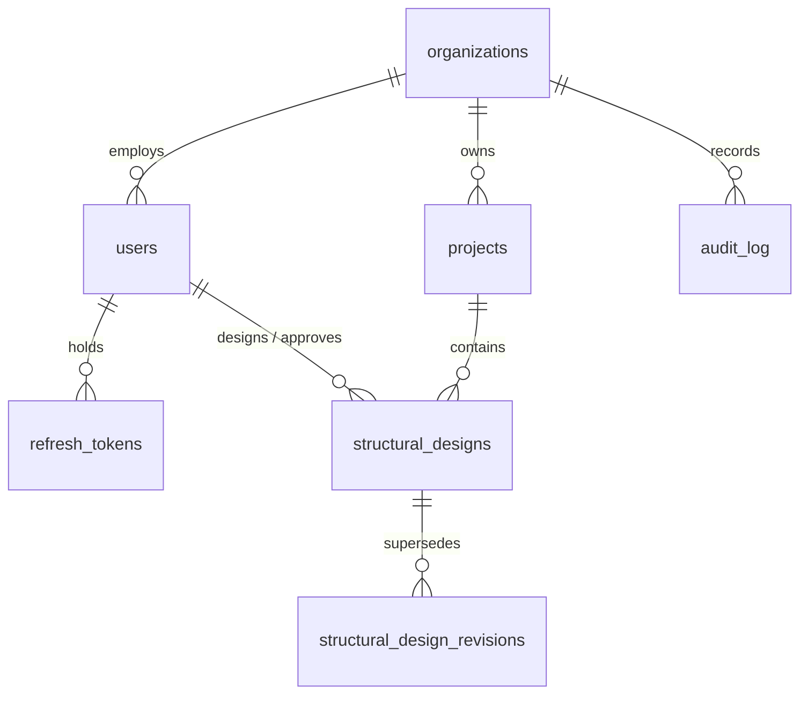

# CivilLabPro OS: database schema

PostgreSQL 16 with PostGIS on servers; SQLite for the offline desktop install. One Alembic history serves both (`backend/alembic/versions/`).

## Conventions (apply to every table, present and future)

| Rule | Detail |
|---|---|
| Keys | `id` UUID, generated by the application |
| Tenancy | every business table has `org_id` → `organizations.id`, indexed, `ON DELETE CASCADE` |
| Time | `created_at`, `updated_at` as `timestamptz`, always UTC |
| Documents | flexible payloads in JSON (`jsonb` on PostgreSQL) beside the columns that are queried |
| Names | snake_case, plural tables; constraints named by convention (`pk_`, `fk_`, `uq_`, `ix_`, `ck_`) |
| Deletion | children cascade from their parent; user references are `SET NULL` with the name copied beside them, so history survives a deleted account |
| Migrations | one revision per change, reversible, checked against the models in CI on both engines |
| Types | only types that exist on both engines; spatial columns are added by PostgreSQL-only migrations with a GeoJSON fallback column |

## Part 1: implemented (revision 0001)

### organizations
| Column | Type | Notes |
|---|---|---|
| id | uuid PK | |
| name | varchar(200) | |
| kind | varchar(40) | consultant, contractor, government, laboratory, academic |
| created_at, updated_at | timestamptz | |

### users
| Column | Type | Notes |
|---|---|---|
| id | uuid PK | |
| org_id | uuid FK | indexed |
| email | varchar(254) | unique, stored lower-case |
| full_name | varchar(200) | |
| designation | varchar(120) | |
| password_hash | varchar(255) | Argon2id |
| role | varchar(20) | owner, admin, engineer, reviewer, viewer |
| is_active | boolean | |
| failed_logins | integer | consecutive failures |
| locked_until | timestamptz null | lockout after five failures |
| last_login_at | timestamptz null | |
| created_at, updated_at | timestamptz | |

### refresh_tokens
| Column | Type | Notes |
|---|---|---|
| id | uuid PK | |
| user_id | uuid FK | indexed, cascade |
| token_hash | varchar(64) | SHA-256 of the token, unique; the token itself is never stored |
| expires_at | timestamptz | |
| revoked_at | timestamptz null | set on rotation, logout, password change, deactivation |
| created_at | timestamptz | |
| user_agent | varchar(300) | |

### audit_log (append-only)
| Column | Type | Notes |
|---|---|---|
| id | uuid PK | |
| org_id | uuid FK | index (org_id, created_at) |
| user_id | uuid FK null | `SET NULL` |
| user_name | varchar(200) | copied, survives account deletion |
| action | varchar(60) | `design.approved`, `project.created`, ... |
| entity_type | varchar(40) | |
| entity_id | uuid null | |
| summary | varchar(300) | one readable line |
| detail | json | changed fields |
| created_at | timestamptz | |

### projects
| Column | Type | Notes |
|---|---|---|
| id | uuid PK | |
| org_id | uuid FK | indexed; unique (org_id, code) |
| code | varchar(40) | job number |
| name | varchar(200) | |
| client, location | varchar(200) | |
| state | varchar(60) | Indian state or union territory; will select the schedule of rates |
| project_type | varchar(40) | building, water_supply, sewerage, highway, bridge, irrigation, industrial, other |
| status | varchar(20) | planning, active, on_hold, completed; indexed |
| description | text | |
| start_date, end_date | date null | |
| created_by | uuid FK null | |
| created_at, updated_at | timestamptz | |

### structural_designs
One row per designed member, whatever its type.

| Column | Type | Notes |
|---|---|---|
| id | uuid PK | |
| org_id | uuid FK | indexed |
| project_id | uuid FK | indexed; index (project_id, element_type); cascade |
| element_type | varchar(40) | key in the element registry (`beam`) |
| name | varchar(120) | member mark |
| status | varchar(12) | ok, not_ok, stopped |
| review_status | varchar(12) | draft, approved |
| revision | integer | starts at 0 |
| engine_version | varchar(20) | version of the engine that produced the result |
| max_utilisation | float null | for lists and dashboards |
| inputs | json | validated input model |
| result | json | key results, calculation sheet, schedule, quantities, drawing |
| designed_by | uuid FK null | last person to save inputs |
| designed_by_name | varchar(200) | |
| approved_by | uuid FK null | |
| approved_by_name | varchar(200) | |
| approved_at | timestamptz null | |
| created_at, updated_at | timestamptz | |

### structural_design_revisions
| Column | Type | Notes |
|---|---|---|
| id | uuid PK | |
| design_id | uuid FK | indexed; unique (design_id, revision); cascade |
| revision | integer | the revision that was superseded |
| status, review_status, engine_version | varchar | as they stood |
| inputs, result | json | as they stood |
| saved_by_name | varchar(200) | |
| created_at | timestamptz | |

## Part 2: planned, by module

These are the designs the modules will be built against. Each becomes real, and may change in detail, in the phase named in [ROADMAP.md](ROADMAP.md). Every table also carries `id`, `org_id`, `created_at`, `updated_at`.

### Platform (phase 2)
| Table | Key columns | Purpose |
|---|---|---|
| roles | org_id null, code, name, permissions json | custom roles per organisation beside the five system roles |
| project_members | project_id, user_id, role | access per project |
| files | project_id null, storage_key, name, media_type, size, sha256, uploaded_by | metadata of every stored file |
| documents | project_id, kind, number, title, revision, status, file_id, issued_at | document control register |
| notifications | user_id, kind, title, body, link, read_at | in-app notifications |
| jobs | kind, status, progress, input json, result json, error, started_at, finished_at | long-running work |

### Standards library (phase 2)
| Table | Key columns | Purpose |
|---|---|---|
| standards | designation (`IS 456`), year, title, body (BIS, IRC, CPHEEO, MoRTH), status, reaffirmed, superseded_by | register |
| standard_amendments | standard_id, number, date, summary | amendment history |
| standard_clauses | standard_id, clause_no, title, summary, tsvector, embedding | clause index for search and for the assistant (no code text shipped) |
| standard_notes | clause_id, org_id, body, author | the organisation's own interpretations |
| bookmarks | user_id, clause_id, note | |

### Quantity estimation (phase 2)
| Table | Key columns | Purpose |
|---|---|---|
| sor_books | authority (CPWD DSR, MoRTH, GWSSB, Gujarat R&B, ...), state, year, title | schedule of rates editions |
| sor_items | book_id, item_code, description, unit, rate, chapter | rate items |
| rate_analyses | project_id, sor_item_id null, description, unit, output_qty, overhead_pct, profit_pct | analysed rates |
| rate_analysis_lines | analysis_id, kind (material, labour, plant, sundries), description, unit, quantity, rate | |
| estimates | project_id, title, kind (abstract, detailed), status, revision | |
| boq_items | estimate_id, item_no, sor_item_id null, description, unit, quantity, rate, amount, source_ref | `source_ref` links a quantity to the design that produced it |
| measurements | boq_item_id, description, nos, length, breadth, depth, quantity | measurement book |
| bills | project_id, kind (running, final), number, period_from, period_to, status | RA and final bills |
| bill_lines | bill_id, boq_item_id, qty_previous, qty_this, rate, amount | |

### Water engineering (phase 3)
| Table | Key columns | Purpose |
|---|---|---|
| water_schemes | project_id, name, design_year, base_population | |
| population_forecasts | scheme_id, method, census json, result json | |
| demand_calculations | scheme_id, per_capita_lpcd, fire_demand, peak_factors json, result json | |
| network_nodes | scheme_id, label, kind (junction, reservoir, tank), elevation, demand, geom | |
| network_links | scheme_id, label, kind (pipe, pump, valve), from_node, to_node, length, diameter, material, roughness, geom | |
| network_runs | scheme_id, job_id, scenario, result json | HGL / EGL results |
| water_designs | scheme_id, element_type (esr, gsr, sump, intake, pump, wtp_unit), inputs json, result json | uses the same registry pattern as structural |

### Sewerage engineering (phase 4)
| Table | Key columns | Purpose |
|---|---|---|
| sewer_networks, sewer_manholes, sewer_reaches | as water, with invert levels, slope, velocity checks | |
| stp_designs | project_id, process (asp, sbr, mbbr, uasb), inputs json, result json | |
| reuse_plans | project_id, demand json, supply json | |

### Highway engineering (phase 5)
| Table | Key columns | Purpose |
|---|---|---|
| alignments | project_id, name, geom | |
| pavement_designs | project_id, kind (flexible, rigid), inputs json, result json | IRC 37, IRC 58 |
| geometric_designs | alignment_id, kind (horizontal, vertical, superelevation), inputs json, result json | |
| cross_sections | alignment_id, chainage, template json, quantities json | |
| road_inventory | project_id, chainage_from, chainage_to, attributes json, geom | |

### Laboratory (phase 6)
| Table | Key columns | Purpose |
|---|---|---|
| lab_samples | project_id null, sample_no, material, source, received_at, condition | |
| test_methods | material, code (IS / IRC / MoRTH reference), name, schema json, limits json | |
| lab_tests | sample_id, method_id, observations json, result json, verdict, tested_by, checked_by | |
| lab_reports | sample_id, report_no, ulr_no, file_id, verify_token, signed_by, issued_at | NABL format, QR verification |
| lab_equipment | name, serial, calibration_due | |

### GIS (phase 7)
| Table | Key columns | Purpose |
|---|---|---|
| gis_layers | project_id null, name, kind, style json, source | |
| gis_features | layer_id, properties json, geom (PostGIS geometry, SRID 4326) / geojson | |
| gis_imports | layer_id, file_id, format (shp, geojson, kml, dxf), status | |

### Project management (phase 8)
| Table | Key columns | Purpose |
|---|---|---|
| tasks | project_id, wbs, name, start, finish, duration, progress, parent_id | Gantt |
| task_links | predecessor_id, successor_id, kind, lag | |
| resources, task_resources | labour, plant, material assignments | |
| daily_reports | project_id, date, weather, work_done json, labour json, plant json | DPR |
| rfis | project_id, number, subject, question, answer, status, due | |
| inspections | project_id, kind (quality, safety), checklist json, result, inspector | |
| inventory_items, inventory_moves | stock by project | |

### AI assistant (phase 9)
| Table | Key columns | Purpose |
|---|---|---|
| assistant_threads | user_id, project_id null, title | |
| assistant_messages | thread_id, role, content, citations json, tool_calls json, tokens | |
| assistant_evaluations | prompt_version, case_id, passed, notes | regression results for prompts |
